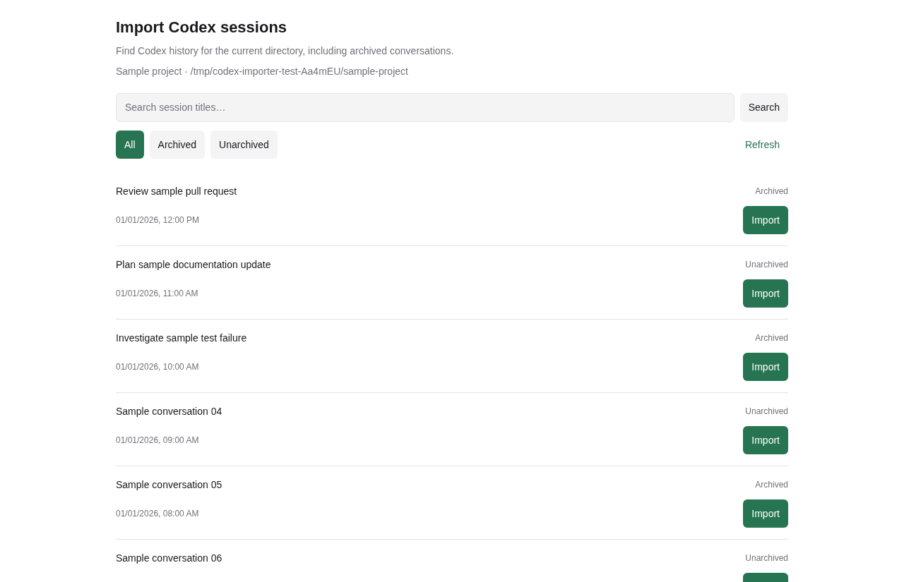

# Codex session importer for Paseo

[简体中文](README.zh-CN.md)

Adds **Import Codex sessions** to the workspace **+** menu. Find and reopen local Codex conversations, including archived history. The interface follows the language selected in Paseo.



## Install

Requires Paseo **0.15.4 or later**, Node.js **22.19 or later**, and Codex CLI **0.167.0 or later** on the daemon machine. Tested on Linux. The panel uses React Native and supports desktop and compact clients.

Enable plugins in **Settings → Plugins**, then install on the host that stores your Codex history:

```sh
paseo plugin install github:tenlee2012/paseo-codex-importer
```

You can also enter `github:tenlee2012/paseo-codex-importer` in Settings → Plugins. Installation obtains the pinned runtime dependencies from the public npm registry. Paseo plugins are trusted code with the daemon user's file and process access.

For an existing GitHub installation, review and apply the update with:

```sh
paseo plugin update codex-importer
```

To install this release directly, add `--ref v0.1.1` to the install command. To update an existing installation to this release without a prompt, use `paseo plugin update codex-importer --ref v0.1.1`.

## Use

1. Open the workspace for the conversation's original working directory.
2. Select **+ → Import Codex sessions**. The action is also available in the Command Center.
3. Search by title or choose **All**, **Archived**, or **Unarchived**.
4. Click **Import**. The importer restores an archived native thread and opens it through Paseo's existing import flow. Labels use your Paseo language.

The list includes non-subagent CLI, editor, app-server, and exec history for the current directory. It follows Codex pagination and orders conversations by last update. Title search follows Codex's search behavior, including case sensitivity. Directory aliases are checked with filesystem real paths.

Native Codex thread IDs remain unchanged. For a matching archived Paseo agent using the same provider and directory, Paseo restores the existing agent ID. Conversations already owned by active Paseo agents, including configured providers extending Codex, are excluded across workspaces. Importing from this panel uses the built-in `codex` provider.

Opening or searching the panel does not unarchive history. Importing restores only the selected thread. Closing an agent tab still follows Paseo's archive behavior; you can find it again with this plugin.

If native restoration succeeds but Paseo import fails, the thread may remain unarchived in Codex. Refresh the list before retrying. Moving history into a different working directory is outside this plugin's scope.

## Language

The plugin follows **Paseo → Settings → Language** in each connected client. With **System**, it uses Paseo's resolved system language. Changing the app language updates menus, panel titles, buttons, accessibility labels, status messages, and errors immediately, preserving search drafts, filters, loaded results, and import feedback.

Supports English (`en`), Arabic (`ar`), Spanish (`es`), French (`fr`), Japanese (`ja`), Korean (`ko`), Brazilian Portuguese (`pt-BR`), Russian (`ru`), and Simplified Chinese (`zh-CN`). Dates, numbers, and plural forms use the client locale. Other plugin locales fall back to English. Each client can display a different language independently.

Session titles, workspace names, paths, and provider names keep their original values. Translation resources ship with the plugin and require no translation service or upload of history. Updating from v0.1.0 replaces the fixed Chinese interface; reload the client if it still displays an older cached bundle.

## Data access

The backend reads the selected host's Codex command and environment from Paseo configuration and calls the local `codex app-server` APIs. It reads Paseo's local daemon identity and local connection credential to use the official Node import client; these values stay in backend memory. It never returns credentials, raw process stderr, or provider error messages to the client or plugin logs.

Conversation titles, directory names, timestamps, and IDs travel to your authorized clients through your existing Paseo connection. The plugin has no telemetry, public data upload, or external history service. Listing and importing do not submit a model turn. Continuing the conversation afterward uses your normal Codex/provider settings.

All repository examples, tests, and screenshots use synthetic data. Real histories, credentials, local configurations, debug artifacts, and databases are excluded from publication. See [PRIVACY.md](PRIVACY.md) for the release checks.

## Develop

```sh
npm ci --legacy-peer-deps --ignore-scripts
npm run typecheck
npm run lint
npm run format:check
npm test -- tests/translations.test.ts
npm test -- tests/codex.integration.test.ts tests/catalog.integration.test.ts tests/imports.integration.test.ts
npm run test:browser
npm run check:privacy
```

Install the Paseo and Codex CLIs before running integration checks. Browser checks require Playwright Chromium (`npx playwright install chromium`) or `PLAYWRIGHT_CHROMIUM_EXECUTABLE` pointing to an existing Chromium executable.

Tests create isolated temporary Codex homes and a separate Paseo daemon on an automatically assigned loopback port. They use synthetic rollout files, start no model turns, and stop only their own temporary daemon. Translation tests use Paseo's real translation engine. Browser checks exercise the real component and plugin RPCs, all nine live languages, independent client languages, locale dates, and preserved query state. Temporary browser bundles and diagnostics go to the ignored `.artifacts/` directory.

Install your checkout with `paseo plugin install /absolute/path/to/checkout`. After source changes, run `paseo plugin reload codex-importer`; a daemon restart is unnecessary.

## References

- [Paseo workspace panels](https://paseo.sh/docs/plugins/reference#workspace-panels)
- [Paseo plugin distribution](https://paseo.sh/docs/plugins/publishing)
- [Paseo runtime translations](https://paseo.sh/docs/plugins/reference#runtime-translations)
- [Codex App Server](https://learn.chatgpt.com/docs/app-server)

MIT licensed. This is an independent community plugin.
