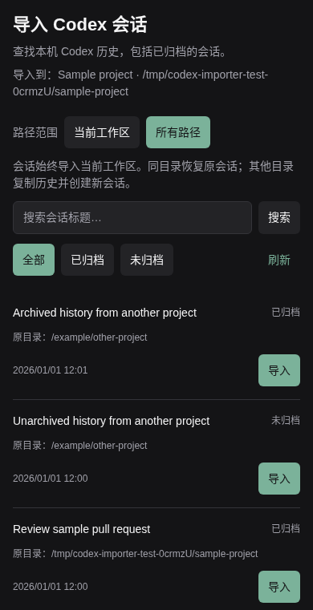

# Paseo Codex 会话导入插件

[English](README.md)

在工作区 **+** 菜单增加 **导入 Codex 会话**，支持找回并导入本机已归档的 Codex 历史。界面跟随 Paseo 客户端的语言设置。



## 安装

Daemon 主机需要 Paseo **0.15.4+**、Node.js **22.19+** 和 Codex CLI **0.167.0+**。已在 Linux 验证；面板使用 React Native，适配桌面和窄屏客户端。

在 **设置 → 插件** 开启插件，然后在保存 Codex 历史的主机执行：

```sh
paseo plugin install github:tenlee2012/paseo-codex-importer
```

也可在插件设置中填写 `github:tenlee2012/paseo-codex-importer`。安装时会从公共 npm 下载锁定的运行依赖。Paseo 插件属于受信任代码，拥有 daemon 用户的文件和进程访问权限。

已安装 GitHub 版的用户可检查并确认更新：

```sh
paseo plugin update codex-importer
```

安装本次发布版本可在安装命令后加 `--ref v0.2.0`。现有安装也可执行 `paseo plugin update codex-importer --ref v0.2.0`，直接更新到指定版本。

## 使用

1. 进入你希望继续工作的目标工作区。
2. 点击 **+ → 导入 Codex 会话**，也可以从命令中心打开。
3. 默认选择 **当前工作区**。切换 **所有路径** 可查看本主机其他目录的历史；每条会话会显示原目录，筛选区上方始终显示导入目标。
4. 搜索标题，或选择 **全部／已归档／未归档**。路径范围和归档状态独立筛选；切换路径范围重新开始分页，同时保留搜索和归档筛选。
5. 点击 **导入**。所有成功导入的会话都归属打开本面板的当前工作区，后续工作目录也使用当前目录。

**同目录恢复原会话**，保留原 Codex 会话 ID。存在同 provider、同目录的 Paseo 归档记录时，复用原 agent ID，并放入当前工作区。目录比较考虑文件系统真实路径，因此符号链接别名也算同目录。

**跨目录复制历史**，通过 Codex 原生 fork 创建新会话 ID，在当前工作区继续。已有自定义标题会保留，原会话及其原 Paseo 工作区会保留。Codex 要求归档来源在复制期间暂时解除归档，插件会在导入副本之前重新归档来源。这个操作不复制项目文件。副本之后在当前目录关闭，可以在这里恢复为同一会话。

列表覆盖所选主机配置的 Codex home 中的 CLI、编辑器、app-server 和 exec 历史，不列出原生子 agent。按最后更新时间排序，支持分页；标题搜索遵循 Codex 的大小写匹配规则。**所有路径**仅改变目录筛选，不切换主机或 Codex 配置。

已被 Paseo 活跃记录占用的会话会跨工作区去重，包括配置中继承 Codex 的 provider。若当前工作区已有某条历史的活跃副本，其来源也会在当前列表排除，避免重复导入；其他工作区仍可导入该来源。此面板使用内置 `codex` provider 及其当前配置。

打开或搜索面板不会改变归档状态。导入仅处理选中的历史。关闭 agent 标签页仍遵循 Paseo 原有的归档规则，之后可以从本插件重新找到。

若历史准备成功、但 Paseo 导入失败，已恢复或复制的历史可能仍保留在 Codex。先刷新 **当前工作区 → 未归档**，查找准备好的副本，再决定是否重试原会话。若恢复来源归档状态失败，或复制时插件停止，请先检查原会话的归档状态。只有返回的 agent 所属工作区和工作目录都匹配导入目标，插件才报告成功。

## 语言

插件跟随每个客户端的 **Paseo → 设置 → 语言**。选择“系统”时，使用 Paseo 解析后的系统语言。切换语言立即更新菜单、面板标题、按钮、无障碍标签、状态和错误提示，并保留搜索草稿、筛选条件、已加载列表及导入反馈。

支持英语（`en`）、阿拉伯语（`ar`）、西班牙语（`es`）、法语（`fr`）、日语（`ja`）、韩语（`ko`）、巴西葡萄牙语（`pt-BR`）、俄语（`ru`）和简体中文（`zh-CN`）。日期、数字与复数形式按客户端语言格式显示；插件未提供的其他语言回退到英文。多个客户端可以各自使用不同语言。

会话标题、工作区名称、路径和 provider 名称保留原始内容。语言资源随插件打包，无需外部翻译服务，也不会上传会话来翻译。从 v0.1.0 更新后，固定中文界面会改为跟随 Paseo 语言；如果仍显示旧缓存，可刷新客户端。

## 隐私和数据流

后端读取当前主机 Paseo 中的 Codex 启动命令和环境变量，调用本机 `codex app-server`。为使用官方 Node 导入接口，还会读取本机 Paseo 身份和连接凭据；凭据只留在后端内存。原始进程 stderr、provider 错误和凭据不会返回客户端或写入插件日志。

标题、目录、时间和会话 ID 仅通过现有 Paseo 连接提供给你授权的客户端。插件没有遥测、公开上传或第三方历史服务。查询和导入不会提交模型对话轮次；之后继续会话时，使用你现有的 Codex/provider 配置。

仓库的测试、示例及截图全部使用合成数据，不发布真实会话、本机配置、日志、数据库或凭据。发布检查见 [PRIVACY.md](PRIVACY.md)。

## 开发

```sh
npm ci --legacy-peer-deps --ignore-scripts
npm run typecheck
npm run lint
npm run format:check
npm test -- tests/translations.test.ts
npm test -- tests/codex.integration.test.ts tests/catalog.integration.test.ts tests/imports.integration.test.ts
npm run test:browser
npm run check:privacy
```

集成测试要求安装 Paseo 和 Codex CLI。浏览器检查要求 Playwright Chromium（`npx playwright install chromium`），也可通过 `PLAYWRIGHT_CHROMIUM_EXECUTABLE` 指定现有 Chromium。

测试使用临时 Codex home、合成历史及独立 Paseo daemon，监听系统分配的本机端口，不提交模型轮次。清理仅停止测试自己的 daemon。翻译测试使用 Paseo 真实翻译引擎；浏览器检查使用真实组件与插件 RPC，覆盖 9 种语言热切换、独立客户端语言、日期格式、查询状态保留、路径范围分页，以及同目录恢复和跨目录复制。构建和诊断文件保存在被忽略的 `.artifacts/`。

本地安装使用 `paseo plugin install /absolute/path/to/checkout`。修改后执行 `paseo plugin reload codex-importer`，无需重启 daemon。

MIT 许可证，独立社区插件。
