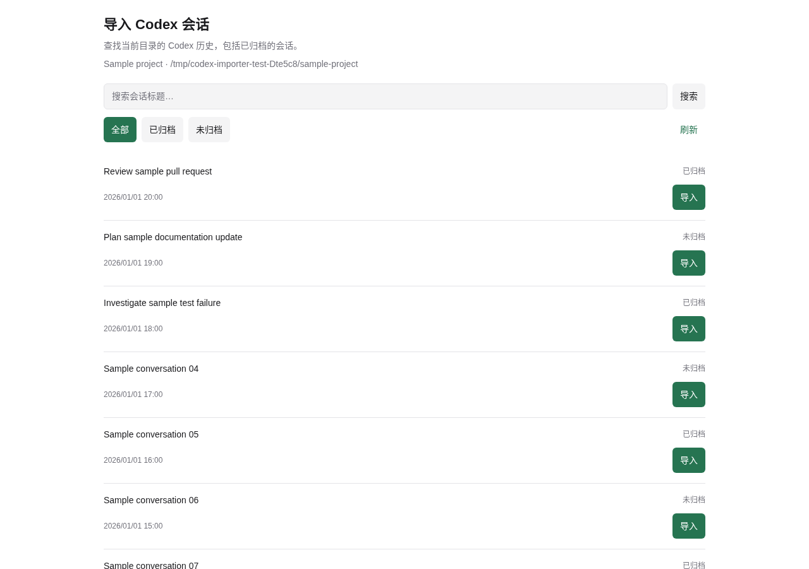

# Paseo Codex 会话导入插件

[English](README.md)

在工作区 **+** 菜单增加 **导入 Codex 会话**，支持找回并导入本机已归档的 Codex 历史。



## 安装

Daemon 主机需要 Paseo **0.15.4+**、Node.js **22.19+** 和 Codex CLI **0.167.0+**。已在 Linux 验证；面板使用 React Native，适配桌面和窄屏客户端。

在 **设置 → 插件** 开启插件，然后在保存 Codex 历史的主机执行：

```sh
paseo plugin install github:tenlee2012/paseo-codex-importer
```

也可在插件设置中填写 `github:tenlee2012/paseo-codex-importer`。安装时会从公共 npm 下载锁定的运行依赖。Paseo 插件属于受信任代码，拥有 daemon 用户的文件和进程访问权限。

## 使用

1. 进入历史会话原目录对应的工作区。
2. 点击 **+ → 导入 Codex 会话**，也可以从命令中心打开。
3. 搜索标题，或选择 **全部／已归档／未归档**。
4. 点击 **导入**，插件恢复选中的 Codex 原生会话，再通过 Paseo 原有流程打开。

列表覆盖当前目录中的 CLI、编辑器、app-server 和 exec 会话，不列出原生子 agent。按最后更新时间排序，支持分页；标题搜索遵循 Codex 的大小写匹配规则。目录比较考虑文件系统真实路径。

Codex 会话 ID 保持不变。若 Paseo 中存在同 provider、同目录的已归档记录，复用原 agent ID。已被 Paseo 活跃记录占用的会话会跨工作区去重，包括配置中继承 Codex 的 provider。此面板通过内置 `codex` provider 导入。

打开或搜索面板不会恢复归档；仅点击导入时恢复选中的会话。关闭 agent 标签页仍遵循 Paseo 原有的归档规则，之后可以从本插件重新找到。插件不负责把会话迁移到其他目录。

若 Codex 已恢复、但 Paseo 导入失败，会话可能保留在 Codex 的未归档列表中，刷新后重试即可。

## 隐私和数据流

后端读取当前主机 Paseo 中的 Codex 启动命令和环境变量，调用本机 `codex app-server`。为使用官方 Node 导入接口，还会读取本机 Paseo 身份和连接凭据；凭据只留在后端内存。原始进程 stderr、provider 错误和凭据不会返回客户端或写入插件日志。

标题、目录、时间和会话 ID 仅通过现有 Paseo 连接提供给你授权的客户端。插件没有遥测、公开上传或第三方历史服务。查询和导入不会提交模型对话轮次；之后继续会话时，使用你现有的 Codex/provider 配置。

仓库的测试、示例及截图全部使用合成数据，不发布真实会话、本机配置、日志、数据库或凭据。发布检查见 [PRIVACY.md](PRIVACY.md)。

## 开发

```sh
npm ci --legacy-peer-deps --ignore-scripts
npm run typecheck
npm run lint
npm run format:check
npm test -- tests/codex.integration.test.ts tests/catalog.integration.test.ts tests/imports.integration.test.ts
npm run test:browser
npm run check:privacy
```

集成测试要求安装 Paseo 和 Codex CLI。浏览器检查要求 Playwright Chromium（`npx playwright install chromium`），也可通过 `PLAYWRIGHT_CHROMIUM_EXECUTABLE` 指定现有 Chromium。

测试使用临时 Codex home、合成历史及独立 Paseo daemon，监听系统分配的本机端口，不提交模型轮次。清理仅停止测试自己的 daemon。浏览器检查使用真实组件，通过真实插件 RPC 访问隔离的后端；构建和诊断文件保存在被忽略的 `.artifacts/`。

本地安装使用 `paseo plugin install /absolute/path/to/checkout`。修改后执行 `paseo plugin reload codex-importer`，无需重启 daemon。

MIT 许可证，独立社区插件。
